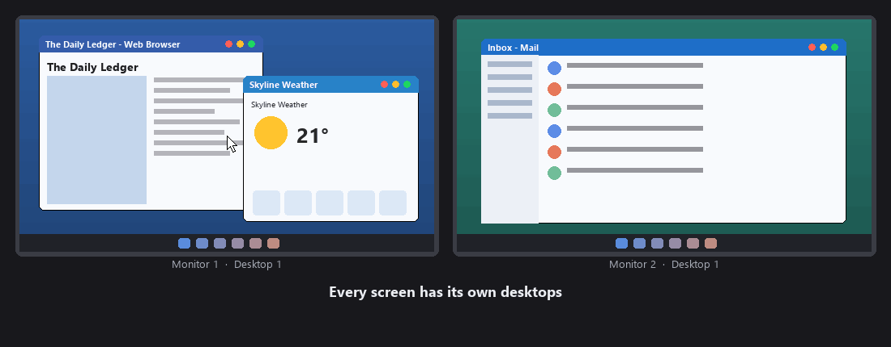
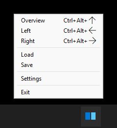
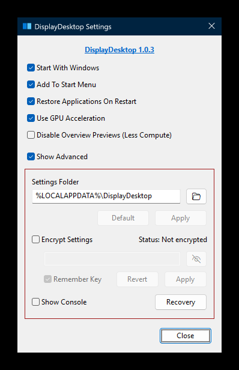
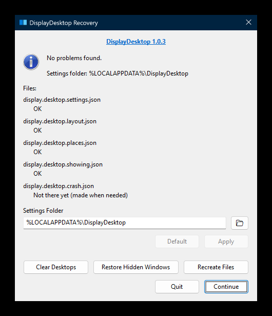
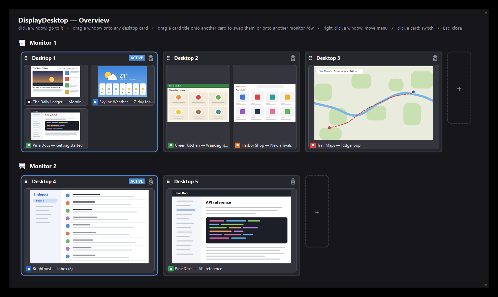

# DisplayDesktop 1.0.3

**Give every screen its own desktops.** Per-monitor virtual desktops for Windows: flip through virtual desktops on the monitor you're working on while your other screens keep showing exactly what they were. Made for multi-monitor setups.



<a href="README.images/tray-menu.png"></a>&nbsp;&nbsp;&nbsp;<a href="README.images/settings.png"></a>&nbsp;&nbsp;&nbsp;<a href="README.images/recovery.png"></a>&nbsp;&nbsp;&nbsp;<a href="README.images/overview.png"></a>

## Features

**No installer, just [download](../../releases/download/1.0.3/DisplayDesktop-1.0.3.zip) and `run`. No dependencies except Python.**

- **Per-Screen Desktops** - Each monitor has its own desktops. Switching changes only the screen under your mouse.
- **Desktops On Demand** - The Overview shows every desktop on every monitor, with previews. Add and delete desktops in the Overview. Drag windows or desktops to rearrange them.
- **Picks Up Where You Left Off** - Windows and desktops are remembered, even when DisplayDesktop quits or Windows shuts down. The next start puts everything back.
- **Save And Load Desktops** - **Save** remembers where every window is. **Load** puts it all back whenever you like.
- **Remembers Each Display Setup** - Windows and desktops are remembered separately for each set of displays, by display name. Attach or detach a display and every window goes back to where it was with those displays.

## Requirements

- Windows 11
- [Python](https://www.python.org/downloads/) 3.10 or newer

## Getting started

Open the DisplayDesktop folder and run:

```
run
```

DisplayDesktop starts in the system tray (two blue screens icon). You can also double-click `DisplayDesktop.pyw`.

| Command | |
|---|---|
| `run` | Start DisplayDesktop |
| `run stop` | Exit (every hidden window comes back) |
| `run restart` | Restart |
| `run status` | Show whether it is running and how it is set up |
| `run recovery` | Opens Recovery: shows what is wrong with each settings file. Restore hidden windows, clear desktops, recreate the settings files, or quit |
| `run enable-startup` / `run disable-startup` | Start automatically when you sign in, or stop doing so |

## Keyboard shortcuts

- **`Ctrl+Alt+←`** / **`Ctrl+Alt+→`** - Previous / next desktop on the screen under the mouse.
- **`Ctrl+Alt+↑`** - Overview of every desktop: switch, drag windows, add or delete desktops.

## Tray menu

- **Overview** - All desktops on all monitors (`Ctrl+Alt+↑`).
- **Left** / **Right** - Previous / next desktop under the mouse (`Ctrl+Alt+←/→`).
- **Load** - Puts windows back where they were saved with the displays attached now.
- **Save** - Saves desktops and window positions for the displays attached now.
- **Settings**
    - **Start With Windows** - Starts at sign-in.
    - **Add To Start Menu** - Adds DisplayDesktop to the Start menu.
    - **Restore Applications On Restart** - After Windows restarts, apps that were open start again and their windows go back where they were.
    - **Use GPU Acceleration** - Runs the desktop slide on the graphics card each monitor is connected to.
    - **Disable Overview Previews (Less Compute)** - The Overview shows app icons for windows on other desktops instead of pictures.
    - **Show Advanced** - Shows these options:
        - **Settings Folder** - Where settings are saved. **Apply** moves them there; **Default** moves them back. If both folders have settings, you pick which to keep.
        - **Encrypt Settings** - Type a key and **Apply** to encrypt every settings file. Unchecking decrypts them.
        - **Remember Key** - Remembers the key on this PC. Off: you're asked at every start.
        - **Show Console** - Shows a log of what DisplayDesktop does.
        - **Recovery** - Shows what is wrong with each settings file. Restore hidden windows, clear desktops (one desktop per monitor; deletes the save), recreate the settings files, or quit.
- **Exit** - Quits. Everything comes back at the next start.

## Encryption (Optional)

When **Encrypt Settings** is on, every settings file is encrypted with AES-256-GCM, and your key is stretched with PBKDF2-HMAC-SHA256.

## Known limitations

- Windows of apps running as administrator can only be managed when DisplayDesktop runs as administrator too.
- `Win+Ctrl+←/→` is Windows' own desktop switch and still switches all monitors. Use `Ctrl+Alt` instead.
- If another program already uses one of the shortcuts, DisplayDesktop shows which ones are unavailable.
- While a not-responding window has the keyboard focus, the shortcuts don't work. Click another window first.

## License

[MIT](LICENSE)

## Fork

DisplayDesktop is a fork of [IndepenDesk](https://github.com/harungecit/IndepenDesk) by harungecit, rewritten from C# to Python. The compiled C# app is an unsigned .exe, which Windows 11's Smart App Control blocks from running. The Python version runs inside the signed `pythonw.exe` from the official Python installer, so it starts normally.
